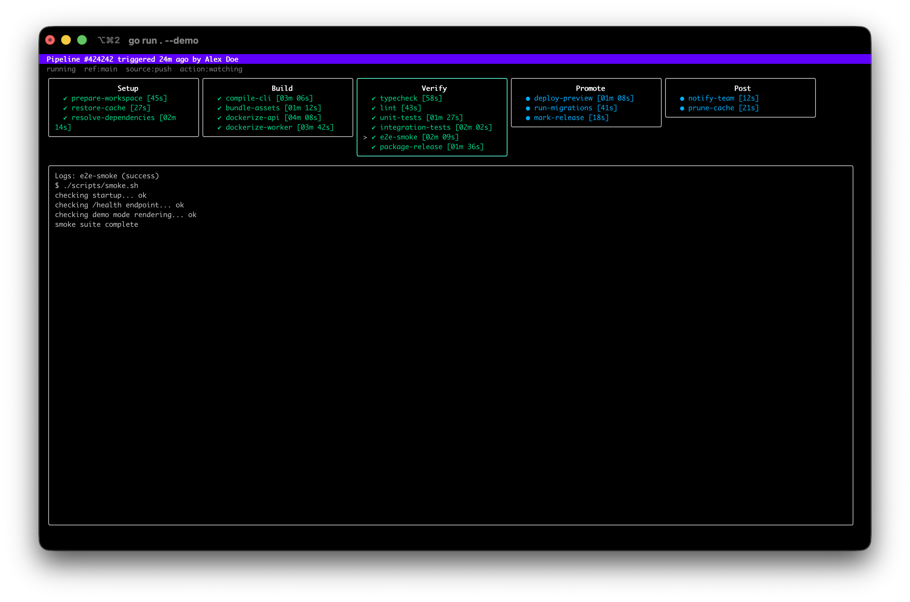

# glab-overseer

`glab-overseer` is a terminal watcher for GitLab pipelines.

It uses the GitLab REST API directly, polls for new pipelines, triggers actions
when a new pipeline appears, and shows live stage/job progress with job logs in
a terminal UI inspired by `glab ci view`.



## Features

- pure HTTP calls to GitLab, no `glab` and no SDKs
- polling-based pipeline detection
- deduped new-pipeline triggers across restarts
- async actions: `none`, `log`, `open`
- stage/job TUI with live trace polling
- nested child/downstream pipelines, including trigger status and every paginated job
- recent pipelines overview homepage
- release binaries for macOS and Linux

## Install

From source:

```bash
go install github.com/arvindell/glab-overseer@latest
```

Or download a binary from GitHub Releases.

With the install script:

```bash
curl -fsSL https://raw.githubusercontent.com/arvindell/glab-overseer/main/install.sh | sh
```

With Homebrew:

```bash
brew tap arvindell/tap
brew install glab-overseer
```

## Config

Copy `.env.example` to `.env` and fill in:

```env
GITLAB_HOST=https://gitlab.com
GITLAB_PROJECT=group/project
GITLAB_TOKEN=your_gitlab_pat
GITLAB_REF=
OVERSEER_POLL_INTERVAL=60s
OVERSEER_TRACE_INTERVAL=15s
OVERSEER_ACTION=log
```

Required:

- `GITLAB_PROJECT`
- `GITLAB_TOKEN`

The token should have `read_api` access.

## Run

```bash
glab-overseer --project group/project
```

Or from the repo:

```bash
go run . --project group/project
```

Useful flags:

- `--demo`
- `--ref`
- `--interval`
- `--trace-interval`
- `--requests-per-minute` (default `30`, shared across metadata and logs)
- `--action`
- `--state-file`

Requests are paced to leave room for CI and other clients sharing the same
GitLab user. The default budget is at most 1,800 requests/hour, including when
older configuration files specify shorter poll intervals. HTTP 429 responses
pause all requests until `Retry-After`/`RateLimit-Reset`, with exponential
backoff if the server omits those headers.

Only the viewed job's log is polled. Completed logs and unchanged completed
pipeline trees are cached; history stage summaries load one pipeline per cycle.
Branch filters apply to both pipeline detection and the recent-pipeline list.
Startup connection errors are retried at the configured poll interval, so starting
before the network is ready does not leave the monitor permanently disconnected.

## Demo Mode

For screenshots or demos without exposing real pipelines, run:

```bash
glab-overseer --demo
```

This uses built-in fake pipeline, job, and log data and does not require a
GitLab token or project.

## Keybindings

- `up` / `down`: move through pipelines in overview mode
- `Enter`: inspect the selected pipeline from the overview
- `b`: go back to the overview from the inspector
- `p`: switch between workload stages and the compact parent-job strip
- `left` / `right`: change workload stage, or parent job when the strip is focused
- `up` / `down`: change job
- `Enter`: open log viewer mode for the selected job
- `Esc`: leave log viewer mode and return to preview mode
- `F`: reactivate default focus mode
- `PageUp` / `PageDown`: scroll logs
- `Ctrl+U` / `Ctrl+D`: half-page log scroll
- `Home` / `End`: jump to top / bottom of logs
- `g` / `G`: top / bottom of logs
- `q`: quit

## Focus Modes

There are two focus modes:

- `default`: automatically cycles through running workload jobs every 10 seconds,
  fetching their first logs without requiring logs to have already been loaded;
  running parent preparation jobs are used when no workload jobs are running
- `user`: activated when you manually move focus

When a new pipeline appears, focus resets to the default mode.

Press `F` at any time to switch back to default mode.

In stage selection mode, the log pane shows a live preview of the latest log
lines for the selected job. Press `Enter` to switch into log viewer mode for
manual scrolling, and `Esc` to return to preview mode.

## Overview Mode

The app now starts on a pipeline overview homepage that shows recent pipelines,
their refs, statuses, authors, and a compact stage summary.

Pipelines appear as soon as the recent list arrives, while job details load in
the background. The overview stays within the terminal height and scrolls to keep
the selected pipeline visible.

Select a pipeline and press `Enter` to inspect it with the detailed stage and
log viewer.

The inspector and overview include jobs from nested child/downstream pipelines,
not just the top-level pipeline. Jobs belonging to parent pipelines, including
selectors and triggers, appear in a compact status strip rather than consuming
workload stage columns. Press `p` to select a parent job with the arrow keys and
inspect its logs or downstream status; press `p` again to return to workloads.
Pending and failed parent jobs stay visible even before their children exist.

Child pipeline IDs and trigger paths are shown in the log heading rather than
repeated on every job row. Trigger jobs show downstream-pipeline status instead
of attempting to load nonexistent logs. Access to downstream projects is required
for multi-project pipelines. Only jobs that GitLab has created can be displayed;
an upstream selection or release gate may omit deployment jobs entirely.

When stages do not fit across the terminal, `left` / `right` scrolls the visible
workload stage columns so every stage and job remains accessible. Tall job lists
scroll with selection, keeping the inspector and logs within the terminal height.

When a new pipeline is detected, the app automatically opens it in inspect
mode immediately, before loading its jobs. Commands queued from an older view
cannot switch it back to an obsolete pipeline. If job loading fails, the new
pipeline remains visible with the error rather than leaving old jobs on screen.
Manual history inspection is still supported. Detection follows the configured
poll interval and shared API rate-limit budget.

If that pipeline succeeds, the UI returns to the overview automatically.

If the currently inspected pipeline fails, the stage and log pane borders turn
red.

## Development

```bash
gofmt -w .
go test ./...
go vet ./...
go build ./...
```

## Project Docs

- [`CONTRIBUTING.md`](./CONTRIBUTING.md)
- [`SECURITY.md`](./SECURITY.md)
- [`CODE_OF_CONDUCT.md`](./CODE_OF_CONDUCT.md)
- [`CHANGELOG.md`](./CHANGELOG.md)
- [`LICENSE`](./LICENSE)
